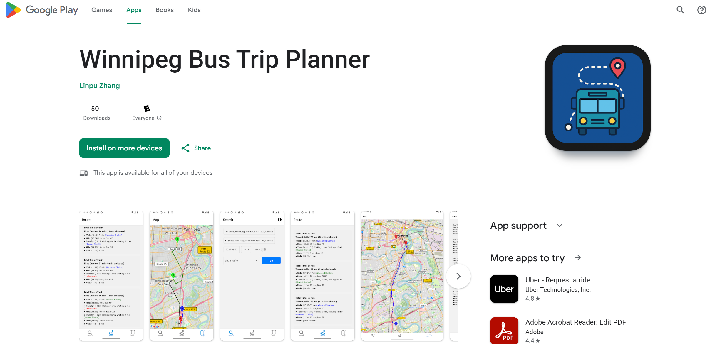
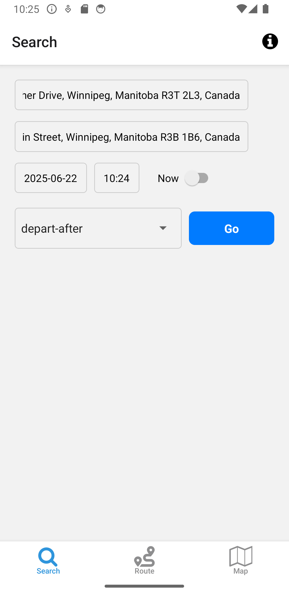
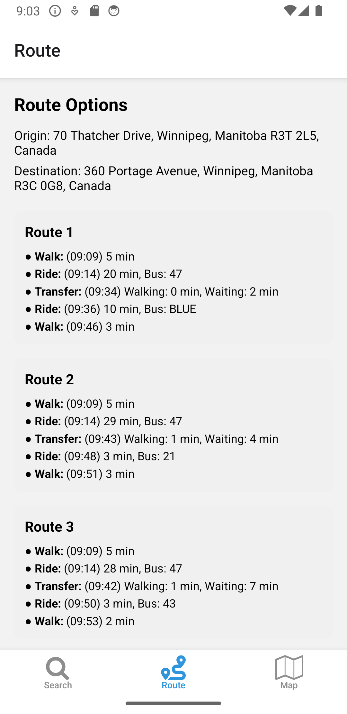
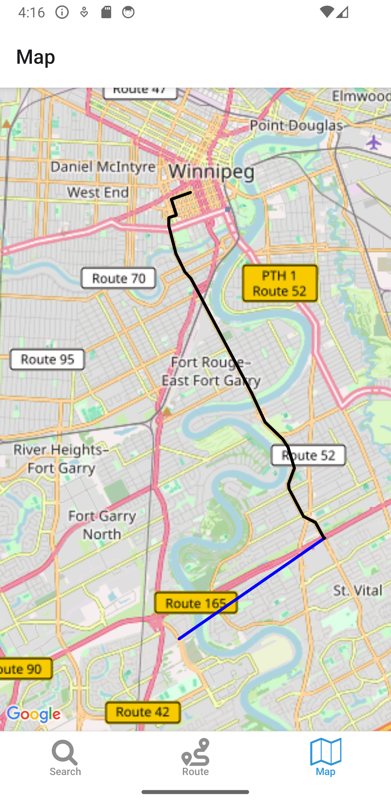

**Winnipeg Bus Trip Planner** is a cross-platform transit app designed to help commuters in Winnipeg easily plan, visualize, and navigate their bus routes. Built using React Native, this mobile app talks to a small companion backend ([BusTripPlanner-backend](../BusTripPlanner-backend)) that proxies the Winnipeg Transit API and Mapbox geocoding and serves bus-route polylines from the Winnipeg Transit GTFS feed.

- Android version is availiable on Google Play -> Search **Winnipeg Bus Trip Planner** or go to:  https://play.google.com/store/apps/details?id=com.anonymous.BusTripPlanner&pcampaignid=web_share



### Key Features
🔍 Smart Trip Planning
- Input origin, destination, date, time, and travel mode to generate multiple route options.

- Automatically fetches and displays detailed trip plans using Winnipeg Transit’s official trip-planner API (via the backend).

- Provide total **waiting time outside** and **sheltered time** for each trip to improve winter travel exprience.

🗺️ Interactive Route Maps
- View the entire bus ride on a map, including bus lines, ride segments, and walk transfers.

- Route polylines come from the Winnipeg Transit **GTFS feed**. The backend matches each ride to the GTFS line that serves its boarding and alighting stops (by stop ID) and returns that stretch with the trip plan, so the map needs no extra requests. Each ride is drawn in its own colour, walking and transfer legs as dashed grey lines, and a straight line is used if a ride has no match. OpenStreetMap tiles underlay the map.

Each ride is highlighted with different colors for clarity.

🚏 Stop Shelter Detection
- Integrates Winnipeg Transit stop features to indicate if a stop has a:

    ✅ Heated Shelter

    🟦 Unheated Shelter

    ⛔ Unsheltered

 - Displays **shelter information** next to walking or transfer segments, improving comfort planning in harsh weather.

 WBTP is currently undergoing closed test in Google Play.

Web prototype version: https://github.com/pricezhang42/Commute-Compass-Vercel

### Architecture

- **App (this repo)** — Expo / React Native client. No upstream API keys are bundled with the app; all third-party calls are proxied by the backend.
- **Backend ([BusTripPlanner-backend](../BusTripPlanner-backend))** — Node + Hono service that holds the Mapbox and Winnipeg Transit credentials, batches the trip-planner + shelter-feature calls, and serves GTFS-based polylines.

Choose separate API/Auth profiles using [connection selection](docs/connections.md). All public connection blocks and independent defaults live in `.env.local`; `.env.example` is the only template.

The only credential still on the client is the **Google Maps Android API key** in [app.json](app.json), used by the native Google Maps SDK. Restrict it in the Google Cloud Console to the app's package name (`com.anonymous.BusTripPlanner`) + release signing SHA-1, and limit it to the **Maps SDK for Android** API.





### Accounts (Supabase)

Search and Map remain available to guests. The Account tab supports email/password
signup, sign-in, sign-out, email confirmation, and password recovery.

1. Create a Supabase project. In Authentication → Providers, enable Email and
   email confirmation. Set the minimum password length to at least 8.
2. Copy `.env.example` to `.env.local`. Set `QA1_SUPABASE_URL` and
   `QA1_SUPABASE_PUBLISHABLE_KEY` to the project URL and publishable key
   (a legacy anon key also works). Never put a secret/service-role key in the app.
3. In Authentication → URL Configuration, allow the exact redirect
   `bustripplanner://auth/callback`. For web development also allow the
   corresponding URL at your actual web origin, for example
   `http://localhost:8081/auth/callback`.
4. In Authentication → Providers → Email, keep the email OTP length at 6 digits
   (the Supabase default). In Authentication → Email Templates → Confirm signup,
   include the code as well as the link, for example
   `<p>Your code is <strong>{{ .Token }}</strong></p>` followed by the default
   `{{ .ConfirmationURL }}` link. In Email Templates → Reset Password, replace the
   body with the code only, for example
   `<p>Your password reset code is <strong>{{ .Token }}</strong></p>`, and no link.
   Configure a production SMTP provider before opening signup to real users;
   Supabase's default mail service restricts recipients and sending volume.
5. Run `npm ci` and `npm run android`. SecureStore is a new native dependency,
   so rebuild an existing development client once. After environment changes,
   restart Metro with `npm run start -- --dev-client --clear`.

After signup succeeds without a session, a dedicated confirmation page shows the
submitted email, a 6-digit code entry, a 60-second resend countdown and “Back to
sign in.” A correct code (`verifyOtp` with type `email`) signs the user in and opens
Account; the email link still works as an alternative. The resend
button uses the existing confirmation callback and restarts its cooldown after a
successful resend (or a server rate-limit response). Deadlines are saved per Auth
project/email using the existing auth storage and recalculated after backgrounding;
returning to signup during an active cooldown reopens the page without sending
another email. Immediate-session signup still opens Account directly. Storage
failures keep the timer in memory and show a warning. Passwords and link tokens
are never stored in this confirmation state or passed in navigation URLs.

Password reset is code-only: “Forgot password?” emails a 6-digit code, the form
switches to a code step with a 60-second resend countdown, and a correct code
(`verifyOtp` with type `recovery`) signs the user in and opens “Choose a new
password.”

Signup email links use PKCE: open them on the same device/browser that requested them.
On an emulator, open the email link inside the emulator browser. An expired,
reused, or cross-device link displays a recoverable error on the callback screen.
Without Supabase configuration, Account displays an unavailable message while
trip planning continues to work. Native sessions use chunked Expo SecureStore;
web sessions use browser localStorage. Passwords are never stored by the app.

Trip planning and geocoding remain public. Saved-data endpoints require verified
Supabase access tokens and retain database RLS. See [saved-data backend setup](docs/saved-items-backend.md).

Manual verification with a configured project:
- As a guest, open Search and Map, including with Supabase configuration absent.
- Create an account, open its confirmation email in the same device, and sign in.
- After signup, verify the confirmation page/email and disabled resend countdown.
  Leave/reopen the page or background the app; the remaining time must not reset.
  After expiry, resend once and check the new countdown, callback link, offline
  error/retry and Back to sign in. Use QA for live email delivery tests.
- Check invalid credentials, mismatched passwords, and network failure messages.
- Restart the app and confirm the account session persists; sign out and restart.
- Request password recovery, enter the emailed code (on any device), set a new
  password, and sign in again. Check a wrong code, an older code after resending,
  and visiting `/auth/reset-password` while signed out.
- Verify dark mode, keyboard layout, and Search/Map navigation after login/logout.

References: [Supabase React Native auth](https://supabase.com/docs/guides/auth/quickstarts/react-native)
and [mobile email links](https://supabase.com/docs/guides/auth/native-mobile-deep-linking).

### Favorite locations, favorite trips, and history

Database migrations and the saved-data API contract are maintained in the
[backend repository](https://github.com/pricezhang42/WinnipegBusTripPlanner-Backend).
Use its versioned migration workflow before testing favorites/history. The API
keeps ownership policies and the latest 10 distinct trips; re-planning a trip
moves it to the top. See [the saved-data contract](docs/saved-items-backend.md).

- Tap either location field to see favorite locations. Typing hides favorites;
  normal geocoding starts at three characters. Clearing shows favorites again.
- Tap an outlined red heart beside a location to save it, or a filled heart to
  remove it. Tapping the heart does not choose that location.
- The history icon beside Origin opens the last 10 different trips searched successfully.
- The red heart beside Destination opens favorite trips. Selecting a trip fills
  both fields; press Go to search with the current date/time settings.
- After a search returns routes, “Save Trip to Fav” saves the searched endpoints.
  Repeated searches of the same trip keep only the latest history entry; duplicate favorites are prevented by
  per-user database keys based on endpoint coordinates. Reverse trips are distinct.
- Guests can plan trips; personal list actions prompt sign-in. Failed or empty
  route searches are not saved. Saved-data failures do not prevent trip planning.

After applying the migration, verify with two accounts that neither can read or
modify the other's rows. Plan 11 different successful trips and confirm history contains
10 records, including after restarting the app. Plan one trip three times and confirm it
appears once, at the top, with the latest time. Also check favoriting a location
from either input, typed-query behavior, favorite removal, offline errors, and
restoring both endpoints from each trip popup.

### Search date and time

Search controls and native date/time pickers use **Winnipeg time**, independent
of the device timezone. Now always searches for departure after the current
instant; its disabled mode picker displays `depart-after`. Turning Now off
restores the selected manual date, time and mode. See the
[time-handling flow and checks](docs/trip-search-time.md).

### Expanded trip itineraries

Use the chevron on the right of a search-result card to expand its itinerary.
Several cards can stay open for comparison. View Map is a separate action;
expanding never navigates away. New search results reset expanded cards.

The timeline shows planned Winnipeg times, stop names/numbers, route and variant
names when supplied, ride durations, transfer walking/waiting, and shelter details.
Walking uses dotted connectors and rides use solid connectors. Dates appear when
an itinerary crosses midnight. Missing times or stop details are labeled rather
than guessed. Ride endpoints can come from immediately adjacent walk/transfer
segments, as in the Transit API. Route badge colors identify legs and are not
claimed to be official route colors. Each ride also shows historical departure timing and, when supported, a pass-up
warning. These describe past observations rather than live predictions. See the
[current reliability flow](docs/trip-reliability-implementation.md).

### Hosted database QA and migrations

SQL migrations, database audits, QA refresh and fixture tools now live in the
[backend repository](https://github.com/pricezhang42/WinnipegBusTripPlanner-Backend).
There is one migration source of truth and no local Supabase instance is required.

Use [independent connection profiles](docs/connections.md) to choose the app's API
server and Auth project separately, for example:

```sh
npm run android -- --api local --auth qa1
```
